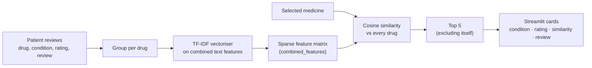

<div align="center">

# Personalised Medicine Recommendation System

**Find medicines similar to the one you know, ranked by text similarity over real patient reviews,<br>
with the condition, average rating and a review excerpt for each match.**

[](https://personalised-medicine-recommendation-system.streamlit.app/)


[](https://huggingface.co/datasets/aman1527/personalised-medicine-files)

[**Launch the app**](https://personalised-medicine-recommendation-system.streamlit.app/) · [Model artifacts](https://huggingface.co/datasets/aman1527/personalised-medicine-files)

</div>

> [!WARNING]
> **For research and education only.** Recommendations reflect text similarity between patient
> reviews, not clinical equivalence. They do not account for dosage, contraindications or drug
> interactions. Never change medication without a qualified healthcare professional.

---

## Overview

A content-based recommender built on patient drug reviews. Pick a medicine from the dropdown and the
app returns the **five most similar medicines**, each with:

| Field | Meaning |
|---|---|
| Medicine | The recommended drug name |
| Condition | The condition it was reviewed for |
| Rating | Average patient rating |
| Similarity | Cosine similarity to the selected medicine (0–1) |
| Review | An excerpt of a real patient review |

An earlier Flask prototype of the same idea lives in
[Code-Clause](https://github.com/Aman-Tripathi27/Code-Clause/tree/main/Golden-Project); this version
uses TF-IDF text features instead of a rating-count pivot, and a Streamlit UI.

## How it works



1. Reviews are grouped into one row per drug, with its condition, rating and a patient review.
2. Each drug's combined text features are vectorised with TF-IDF.
3. When a medicine is selected, its TF-IDF vector is compared with every other drug by cosine similarity.
4. The five closest drugs, excluding the query itself, are shown with their context.

The fitted artifacts are built offline and hosted on Hugging Face, so the app holds no training code
and starts from the published files.

## Getting started

```bash
git clone https://github.com/Aman-Tripathi27/Personalised-medicine-recommendation-system.git
cd Personalised-medicine-recommendation-system
python -m venv .venv && source .venv/bin/activate
pip install -r requirements.txt
streamlit run app.py
```

On first launch the app downloads its artifacts from the
[Hugging Face dataset](https://huggingface.co/datasets/aman1527/personalised-medicine-files)
(about 750 MB in total) and caches them with `st.cache_resource`, so later recommendations are instant.

| Artifact | Contents |
|---|---|
| `grouped.pkl` | One row per drug: name, condition, average rating, review |
| `tfidf.pkl` | The fitted TF-IDF vectoriser |
| `combined_features.pkl` | TF-IDF matrix used for similarity search |
| `similarity_matrix.pkl` | Precomputed drug-by-drug similarity matrix |

## Project structure

```text
Personalised-medicine-recommendation-system/
├── app.py                  # Streamlit app: loads artifacts, cosine search, result cards
├── requirements.txt        # streamlit, pandas, numpy, scikit-learn, scipy, gdown
├── tfidf.pkl               # local copy of the fitted vectoriser
└── combined_features.pkl   # local copy of the TF-IDF feature matrix
```

## Tech stack

| Area | Tools |
|---|---|
| Recommendation | scikit-learn (TF-IDF, cosine similarity) |
| Data | pandas, NumPy, SciPy |
| App | Streamlit |
| Artifact hosting | Hugging Face Datasets |
| Deployment | Streamlit Community Cloud |

## Limitations

- Similar review language does not mean similar pharmacology; two drugs can read alike and act differently.
- Ratings are self-reported and unevenly distributed across drugs; rarely reviewed drugs are noisier.
- Recommendations are not filtered by the user's own condition yet.

## Roadmap

- [ ] Condition-based filtering, so results stay within the user's condition
- [ ] Learned embeddings (for example sentence transformers) instead of TF-IDF
- [ ] A feedback loop to tune results from user ratings
- [ ] Drop the unused similarity matrix from the startup download to cut cold-start time

---

<div align="center">
<sub>Built by <a href="https://github.com/Aman-Tripathi27">Aman Tripathi</a> · <a href="https://amantripathii.netlify.app">Portfolio</a> · <a href="https://www.linkedin.com/in/aman-tripathi27/">LinkedIn</a></sub>
</div>
